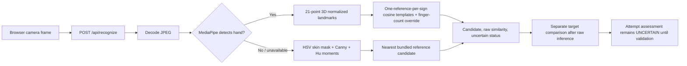

# Recognition ML Audit: Evidence, Blockers, and Evaluation Plan

Companion artifacts: [dataset inventory](DATASET_INVENTORY.md), [model card](MODEL_CARD.md), and [environment/camera readiness](ENVIRONMENT_READINESS.md).

**Status: evaluation blocked; no model is approved to mark learner attempts correct.**

This audit distinguishes the repository's stored prediction ledger from a
reproducible model evaluation. The ledger can be scored, but the image data and
split metadata required to verify those predictions are absent.

## Findings from source inspection

### Active inference is not the saved BoVW/SVM model

`src/recognition/engine.py` does not load `svm_model.sav` or
`mini_kmeans_model.sav`; they are not active models. The camera path uses
MediaPipe hand landmarks, compares normalized landmark vectors to one
reference image per available class, adds fixed bonuses for matching
finger-count heuristics, and overrides the nearest reference with hard-coded
rules for numerals 1–5. If MediaPipe is unavailable, it uses fixed HSV skin
segmentation, Canny edges, Hu moments, and nearest-reference similarity. There
is no trained classifier in either active path.

The original `recogniseGesture.py` does use the saved KMeans and SVM, with
class labels derived from sorted directories under `data/`. That `data/`
directory is not present in this checkout, so the label ordering cannot be
verified against the saved pickle files here. The original preprocessing
requests SURF through `cv2.xfeatures2d.SURF_create()` (despite naming the
helper SIFT); current runtime preprocessing uses a different pipeline.

### Sources of fabricated certainty

- The older target-conditioned form path could return the requested target as
  `predicted_sign` whenever its heuristic form evaluator returned `CORRECT`.
  Comparing that output with the target made the comparison tautological.
- `pose_analyzer.py` generates confidence-like constants and formulas such as
  `0.85 + steadiness * 0.10`; these are not fitted or calibrated probabilities.
- The landmark engine previously forced a minimum score of `0.85` for a
  discrete finger-rule result and supplied `0.85` when no reference profiles
  existed. The fallback Hu score and margin were also treated as acceptance
  evidence using thresholds without validation data.
- The assessment layer previously marked those heuristic values as
  calibrated. This was false. In the current checkout, I found no literal
  `100% match confidence` string in the active source. The prior interface
  formatted an assessment confidence as a percentage; the 100% observation
  progress indicator is a separate ten-frame counter. Historical persisted UI
  or browser state is unavailable, so the exact displayed 100% event cannot
  be reproduced from this checkout.

### Current safety behavior

The recognition engine now returns an uncertain candidate with an explicitly
unvalidated template-similarity score, not a confidence probability. It no
longer fabricates a minimum similarity or the fallback candidate `1`. The
assessment object does not grade any candidate correct or incorrect because
there is no independently validated recognition or pose evidence. Such
attempts do not update mastery. This is an intentional fail-closed behavior,
not a claim that recognition has been fixed or validated.

## What the 8,400-row CSV establishes

`submission_svm.csv` contains only `ImageId`, `PredictedLabel`, and
`TrueLabel`. Independent arithmetic over those rows gives:

- 8,400 rows; 35 classes; exactly 240 rows per class.
- Image IDs are sequential from 1 through 8,400.
- One disagreement: true numeric label 1, predicted numeric label 2.
- Accuracy: 8,399 / 8,400 = **99.9881%** (rounds to 99.99%).
- Class 1: precision 1.0000, recall 0.9958, F1 0.9979.
- Class 2: precision 0.9959, recall 1.0000, F1 0.9979.
- The other 33 classes: precision, recall, and F1 are 1.0000 in this ledger.
- The only confusion is 1 → 2 (IDs; corresponding signs depend on the
  unverified original directory-to-class mapping).

These are **prediction-ledger metrics only**. The CSV has no image filenames,
participant or session IDs, capture conditions, model version, split method,
or confidence scores. It cannot show that the saved model produced these
predictions, uncover duplicate-image leakage, support an independent split,
measure latency, or establish generalization. The uniform per-class support
and sequential IDs warrant provenance verification; they do not by themselves
prove leakage. No raw training/test images or participant-grouped manifests
exist in this checkout. Consequently there are no defensible per-class
real-world metrics, confusion matrix for a reproducible evaluation, false
acceptance rate, calibration results, or latency results to report.

## Model comparison decision

No alternative was adopted. The available evidence is insufficient to compare
the saved SURF/BoVW/SVM pipeline with the current single-reference landmark
matcher or another lightweight classifier. The latter is not a trained
landmark classifier and the 35 bundled reference images are not a test set.
Reporting a winner based on these materials would invent evidence.

## Required data collection and evaluation protocol

1. Collect consented webcam sessions from multiple signers. Include all 35
   intended classes plus no-hand/face-only, wrong-sign, incomplete pose,
   transition, occlusion, out-of-frame, and lighting/background negatives.
2. Store labels, signer ID, session ID, capture condition, target sign,
   completeness/transition annotation, and original image/frame path in a
   versioned manifest. Keep frames from a signer/session together; deduplicate
   exact and near-duplicate images before splitting.
3. Reserve signers for a locked test set before tuning. Use training signers
   for fitting and validation/calibration only. Report a second condition-held
   out set where practical. Keep all transitions from one recording in one
   split.
4. Re-run both pipelines on the same frames with their actual inference
   preprocessing. Record per-class precision/recall/F1, full confusion
   matrices, correct-sign acceptance on incomplete/wrong/negative frames,
   coverage versus abstention, and CPU/device latency including preprocessing.
5. Compare raw SVM decision margins and template similarities as scores, not
   probabilities. If useful, calibrate on a signer-disjoint validation set
   (for example, sigmoid or isotonic calibration), report reliability plots
   and Brier/log loss, then choose rejection thresholds on validation only.
   Do not change thresholds after looking at the locked test results.
6. Validate each proposed pose check against independent frame annotations
   for the supported signs. Unvalidated orientation/finger rules remain
   unavailable and cannot override model uncertainty.
7. Run the end-to-end webcam workflow against the locked scenarios and retain
   anonymized aggregate results plus reproducible environment/model hashes.

Until this collection and evaluation exists, learner-facing feedback must
describe model outputs as possible candidates and leave mastery untouched.

## Active inference path and diagnostics (implementation status)



Source locations:

- Browser capture and request: `src/static/js/app.js` (`captureAndRecognizeFrame`).
- HTTP boundary and post-inference target comparison: `src/server/app.py` (`/api/recognize`).
- Active recognizer, preprocessing, templates, candidate and raw score:
  `src/recognition/engine.py` (`RecognitionEngine`).
- MediaPipe model input and normalized landmark vector:
  `src/recognition/pose_analyzer.py` (`analyze_frame`, `_extract_hand_features`).
- Final attempt status, separate from the raw candidate:
  `src/engine/assessment.py` (`assess_attempt`).
- The authoritative assessment object is returned to the feedback UI and now
  persisted as JSON with its raw score and score type; the database's legacy
  `model_confidence` field remains null unless an actual probability exists.
- Saved SVM/KMeans models are no longer loaded by the active engine. SIFT
  reference descriptors were also removed because they were never consumed.
  The `.sav` files and original `recogniseGesture.py` are legacy artifacts,
  not the active recognizer.
- `recognize_frame` does not read its compatibility `target_sign` parameter;
  the HTTP endpoint no longer passes the target to raw inference. The response
  includes `target_comparison` as a separate, explicitly unvalidated object.
- Set `SIGNSENSE_DIAGNOSTICS=1` to append metadata-only JSONL records (model
  version, preprocessing path, input validity, candidate, score/type, latency).
  Override the path with `SIGNSENSE_DIAGNOSTICS_PATH`. No frame, landmark,
  participant, or target data is written.

## Labeled collection schema and procedure

Run the collector only after reading `research/CONSENT_AND_PRIVACY.md` and
obtaining consent from each participant specifically for storing selected
still images. The preview is not written as video. The collector requires an
explicit consent flag and typed confirmation; samples are ignored by Git.
Use a pseudonym, never a participant's name, email, or other direct identifier.

```powershell
python tools/collect_webcam.py --consent --participant P001 --session S001
python -m unittest tests.test_ml_pipeline
```

Press **C** to capture a selected still and **Q** to quit. For every still,
record the prompted target, actual complete sign when applicable, category,
and a plain capture-condition description. Collect all signs 1–9 and A–Z in
each needed category: `correct_sign`, `other_sign`, `incomplete_pose`,
`transition`, `no_hand`, `face_only`, and `tracking_failure`. Face-only stills
require the extra identifiable-still consent flag and signed consent. For `other_sign`, actual sign
must differ from target. A no-hand/transition/incomplete sample may have no
`actual_sign`. The form rejects inconsistent labels. Adjacent frames with
dHash Hamming distance <= 4 are skipped; exact SHA-256 and near-duplicate
checks also run over the complete manifest before evaluation.

Each JSONL row contains `sample_id`, relative `image_path`, SHA-256,
`perceptual_hash`, `participant_id`, `session_id`, `target_sign`,
`actual_sign`, `category`, `capture_condition`, consent flags/timestamp, and
capture timestamp. Images remain local under ignored `data_collection/`.
Participants can withdraw by pseudonym; delete their rows and files before
publishing any derived dataset. Do not upload images without separate
permission.

## Reproducible actual-pipeline baseline

After collecting at least three participants and validating manifest labels,
run:

```powershell
python tools/evaluate_recognizer.py --manifest data_collection/manifest.jsonl --seed 20261018 --output reports/current_template_baseline.json
```

This assigns whole participants (and all their sessions) to 60/20/20
train/validation/test partitions with seed `20261018`; the current baseline
does not fit or tune on them, but uses the held-out participants for reporting.
The runner records candidate top-1 class metrics, sparse confusion counts,
per-category candidate coverage/rejection, target-candidate matches and
accepted target false accepts, and mean/p95 inference latency. The current
prototype always returns uncertain, so accepted coverage is expected to be
zero; candidate confusion metrics are diagnostic only. Negative target
candidate matches remain separately visible. Missing participant groups or
manifest quality errors stop evaluation.

Current baseline status: **not run**. No collection manifest is present. No
per-class or false-acceptance rates from a real independent image split are
available. The earlier CSV ledger is not an input to this runner.

## Experimental landmark SVC candidate

The separate candidate in `src/ml/landmark_svc.py` uses the MediaPipe 3D
landmark vectors (up to two hands, normalized relative to wrist and hand
scale), a StandardScaler, and an RBF SVC (`C=1`). It is experimental and is
not wired into practice inference. It fits only `correct_sign` examples in
training participants. It uses an uncalibrated one-vs-rest decision score,
not probability. The rejection threshold is selected on validation
participants only to satisfy the requested maximum false-accept rate on
target-labeled negative categories while retaining as many correct target
examples as possible.

```powershell
python tools/train_landmark_candidate.py --manifest data_collection/manifest.jsonl --seed 20261018 --max-validation-false-accept-rate 0.05 --output ml_models/landmark_svc.joblib
python tools/evaluate_recognizer.py --manifest data_collection/manifest.jsonl --seed 20261018 --landmark-model ml_models/landmark_svc.joblib --output reports/model_comparison.json
```

The training command stops if training lacks tracked correct examples for any
of the 35 signs, if validation lacks positive and target-labeled negative
examples, or if fewer than three participants exist. The comparison command
uses the same held-out test participants for both candidates. Do not select a
production model unless those test results support the choice; do not tune on
the test set.

## Run status and blockers in this checkout

See [Environment and camera readiness](ENVIRONMENT_READINESS.md) for the
reproducible interpreter/package report, full-suite result, and camera probe.

- No `data_collection/manifest.jsonl` exists, so neither candidate has a
  participant-held-out image evaluation, false-acceptance result, or measured
  recognition latency. The CSV ledger arithmetic above is not evidence for
  either active path. Local references and historical predictions are not
  accepted as training or test samples; see the inventory.
- The current repository-local CPython 3.12.14 environment imports OpenCV,
  MediaPipe, scikit-learn, and SciPy successfully; MediaPipe's task model
  initializes, and `pip check` is clean. The camera probe tried indices 0, 1,
  and 2, none of which opened. No user/session collection or live coach test
  could be run. See the readiness report for exact probe output.
- Syntax, environment, and automated-test results are recorded in the current
  task completion note. Those checks do not substitute for an independent
  signer-held-out evaluation.
- The earlier misleading 100% event cannot be reconstructed from saved UI
  state or a diagnostic log. The source-level defect that could fabricate a
  match was the old target-conditioned form path: it could set the returned
  candidate to the requested target when an unvalidated heuristic said
  `CORRECT`, making target comparison tautological. Confidence-like pose
  formulas compounded that error. That path has been removed from active raw
  inference; the current code intentionally provides no calibrated confidence
  and does not grade a candidate as correct.

The application dependencies can be installed with
`python -m pip install -r requirements.txt`. To run the currently available
stdlib checks:

```powershell
python -m unittest tests.test_ml_pipeline tests.test_trustworthy_assessment -v
```
